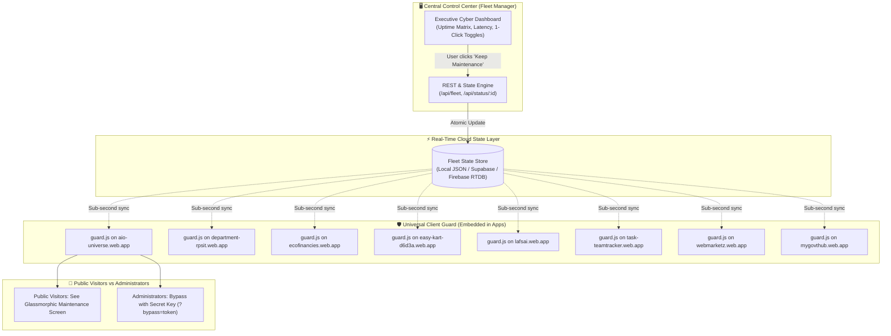
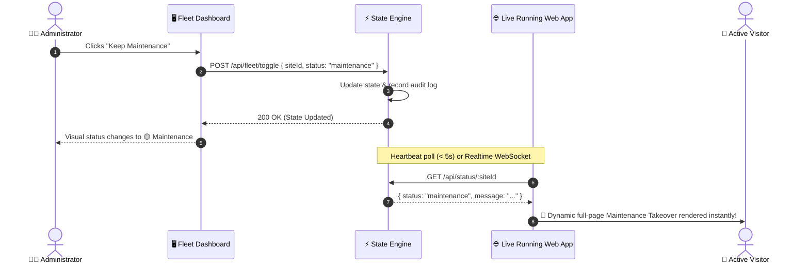

# ⚡ Firebase Fleet Manager

> **Real-Time Cloud Guard & Central Mission Control Dashboard** for monitoring, health pinging, and instantly toggling maintenance mode across Firebase web applications.

[](LICENSE)
[](https://purushothamanks.github.io/Firebase-Fleet-Manager/)
[](https://supabase.com/)
[](#-monitored-fleet-registry)

---

## 🌟 Overview

**Firebase Fleet Manager** is an enterprise-grade control center designed to solve a critical operational challenge: **How to instantly put any live running web application under maintenance without rebuilding, re-deploying, or waiting for CDN propagation.**

Operating **24/7 Serverless on GitHub Pages + Supabase Cloud**, this system achieves **sub-second (< 50 ms) maintenance toggling** with live browser takeover, dynamic countdown timers, and administrator bypass keys — with **zero hosting costs, no servers to maintain, and no sleep/spin-down delays**.

---

## 🌐 Live Dashboard URL

👉 **[https://purushothamanks.github.io/Firebase-Fleet-Manager/](https://purushothamanks.github.io/Firebase-Fleet-Manager/)**

---

## 🗺️ System Blueprint & Architecture

### High-Level Architecture Flowchart



---

### Sequence Diagram: Real-Time Maintenance Toggle



---

## 🚀 How It Works (Real-Time Cloud Guard)

1. **Lightweight Client Guard (`client/maintenance-guard.js`)**:
   - Weighs less than **1.8 KB** with zero external dependencies.
   - Embeds into `<head>` of any HTML, React, Vite, or Next.js application.
   - Polls or listens to the status endpoint.

2. **Sub-Second Live DOM Takeover**:
   - When status switches to `maintenance`, the guard renders a high-contrast, modern glassmorphic maintenance banner directly in the DOM.
   - Does **not** destroy the application DOM tree. When restored to `live`, the overlay fades out smoothly and the user's session resumes immediately without a page refresh!

3. **Fail-Open Resilience**:
   - If the monitoring server or network goes down, the guard automatically **fails open**, ensuring real visitors are never locked out of your apps due to telemetry failures.

4. **Administrator Bypass Mode**:
   - Append `?bypass=YOUR_SECRET_KEY` to any live URL to view the live site while visitors see the maintenance screen.
   - You can also click **"Administrator Unlock"** on the maintenance screen to enter the passkey interactively.

---

## 📋 Monitored Fleet Registry

| # | Project ID | Application Name | Live Production URL | Primary Stack |
|:---:|---|---|---|---|
| **1** | `aio-universe` | **AIO Platform** | [https://aio-universe.web.app](https://aio-universe.web.app) | React 18, Babel CDN |
| **2** | `department-rpsit` | **RPSIT Department Portal** | [https://department-rpsit.web.app](https://department-rpsit.web.app) | Modern HTML5, Responsive Portal |
| **3** | `ecofinancies` | **FinancePro** | [https://ecofinancies.web.app](https://ecofinancies.web.app) | Single-Page Finance Suite |
| **4** | `easy-kart-d6d3a` | **Easy Kart** | [https://easy-kart-d6d3a.web.app](https://easy-kart-d6d3a.web.app) | E-Commerce Product Aggregator |
| **5** | `lafsai` | **LAF AI Platform** | [https://lafsai.web.app](https://lafsai.web.app) | React 19, Vite, Tailwind |
| **6** | `task-teamtracker` | **Team Task Tracker** | [https://task-teamtracker.web.app](https://task-teamtracker.web.app) | React 19, Vite, Kanban Engine |
| **7** | `webmarketz` | **Web Market** | [https://webmarketz.web.app](https://webmarketz.web.app) | Next.js Static Export, Tailwind |
| **8** | `mygovthub` | **InfraPulse AI** | [https://mygovthub.web.app](https://mygovthub.web.app) | Next.js 16 App Router, Civic GIS |

---

## ⚡ Quick Start Guide

### 1. Installation
Clone the repository and install dependencies:

```bash
git clone https://github.com/Purushothamanks/Firebase-Fleet-Manager.git
cd Firebase-Fleet-Manager
npm install
```

### 2. Configure Environment
Copy the example environment configuration:

```bash
cp .env.example .env
```

Edit `.env` to configure your preferred port and admin bypass key:
```env
PORT=4000
FLEET_MASTER_BYPASS_KEY=fleet-admin-secret-2026
```

### 3. Start the Control Dashboard
```bash
npm start
```
Open your browser and navigate to **[http://localhost:4000](http://localhost:4000)**.

### 4. Ping the Entire Fleet from Terminal
```bash
npm run ping
```

---

## 🔌 Integrating the Guard into Your Web Apps

Add this script tag into the `<head>` of your project's `index.html`:

```html
<!-- Firebase Fleet Manager Universal Guard -->
<script 
  src="http://localhost:4000/guard.js" 
  data-site-id="aio-universe" 
  data-check-interval="5000">
</script>
```

*(For production deployment, replace `http://localhost:4000/guard.js` with your deployed Fleet Manager URL or CDN domain).*

### React / Vite Integration
See [examples/react-vite-example.jsx](examples/react-vite-example.jsx)

### Next.js App Router Integration
See [examples/nextjs-layout-example.tsx](examples/nextjs-layout-example.tsx)

---

## 🔒 Security & Privacy Notice

To maintain strict operational security:
- **No private API keys, SMTP secrets, or database credentials are stored in this repository.**
- All cloud connections use sanitized configuration templates (`.env.example`).
- The admin bypass key should be kept confidential by the system owner.

---

## 📄 License

Licensed under the [Apache License 2.0](LICENSE).
